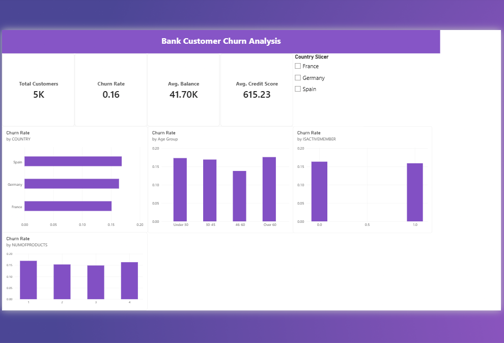

# Bank Customer Churn Analysis

End-to-end data analytics project: cleaning a raw bank customer dataset in Python, loading it into a cloud data warehouse (Snowflake), answering business questions with SQL, and building a live, interactive Power BI dashboard.

## Dashboard

## Project Overview

Customer churn (customers leaving the bank) is one of the most expensive problems a retail bank faces. This project analyzes a dataset of 5,000 bank customers to identify which customer segments churn the most, so the bank can prioritize retention efforts.

Workflow: Raw data to Python cleaning to Snowflake SQL analysis to Power BI dashboard.

## Repository Structure

Bank.ipynb is the Python notebook used to clean the raw dataset. sql/churn_analysis.sql holds the SQL business-question queries run in Snowflake. bank_data_clean.csv is the cleaned dataset. Bank_Data_Churn.pbix is the Power BI dashboard file. Dashboard.png is a screenshot of the finished dashboard.

## Dataset

The raw dataset started as 5,095 bank customer records with 15 attributes: CustomerID, Customer Name, Age, CreditScore, Country, Gender, Tenure, Balance, NumOfProducts, HasCrCard, IsActiveMember, EstimatedSalary, Branch, JoinDate, and Exited, the churn target where 1 means churned and 0 means retained. It was deliberately messy, simulating real-world exports from multiple systems.

## Data Cleaning (Python and pandas)

The raw data had a wide range of real-world quality issues, all handled in Bank.ipynb.

95 duplicate CustomerIDs were found and removed, keeping the row with the most complete Age data for each customer, bringing the dataset down to a clean 5,000 rows.

Customer Name values had inconsistent whitespace, which was stripped.

Age contained impossible values such as negative numbers and values like 150 and 999. These were flagged as missing and filled with the median age. Nulls were handled the same way.

CreditScore contained impossible values outside the valid 300 to 850 range, including placeholders like -999 and 9999. These were flagged as missing and filled with the median credit score.

Country had inconsistent casing and a German synonym, such as germany, GERMANY, and Deutschland all meaning the same thing. These were normalized into three clean categories: Germany, France, and Spain.

Gender had inconsistent casing and abbreviations, such as M, male, MALE, and Male. These were normalized into two clean categories: Male and Female.

Balance was stored as text with currency symbols and formatting, such as euro signs, the word EUR, and thousands separators. This was converted to a clean numeric type, and impossible negative balances were flagged as missing and filled with the median.

HasCrCard and IsActiveMember were stored inconsistently as a mix of 1/0, Yes/No, and Y/N. These were standardized into clean binary 1/0 columns.

EstimatedSalary had missing values and some impossible negative numbers, both handled by filling with the median.

Branch names had inconsistent casing and spacing, such as munich hbf and Munich Hbf, which were standardized to proper title case.

JoinDate was stored in multiple date formats, such as DD/MM/YYYY, YYYY-MM-DD, and DD-Mon-YYYY. These were parsed into a single consistent date type.

The final cleaned dataset has 5,000 rows, 15 columns, zero missing values, and zero duplicate rows.

## Tools Used

Python with pandas for data cleaning and preparation. Snowflake as the cloud data warehouse, with SQL for business question analysis. Power BI for an interactive dashboard connected live to Snowflake, using DAX measures, calculated columns, and slicers.

## SQL Analysis in Snowflake

The cleaned data was loaded into a Snowflake table and queried to answer four core business questions. See sql/churn_analysis.sql for the full queries.

Churn rate by country: Spain 16.85 percent, Germany 16.38 percent, France 15.09 percent.

Churn rate by number of products: no strong pattern, with rates across 1 to 4 products ranging narrowly from about 14.9 percent to 16.9 percent.

Churn rate by active membership: inactive members 16.33 percent, active members 15.89 percent, a modest gap.

Churn rate by age group: Over 60 at 17.60 percent, Under 30 at 17.30 percent, 30 to 45 at 16.91 percent, and 46 to 60 at 13.79 percent, the most loyal segment.

## Power BI Dashboard

An interactive dashboard was built in Power BI, connected live to Snowflake via Import mode. It features KPI cards for Total Customers, Churn Rate, Average Balance, and Average Credit Score, a Churn Rate by Country chart, a Churn Rate by Age Group chart with custom sorting via DAX calculated columns, a Churn Rate by Active Membership chart, a Churn Rate by Number of Products chart, and a Country slicer for interactive filtering.

## Key Insights

Spain has the highest customer churn rate among the three countries. Customers aged 46 to 60 are the most loyal segment, while both younger and older customers churn more. Inactive membership is associated with slightly higher churn, though the effect is modest. Number of products held does not show a strong relationship with churn on its own.

## Skills Demonstrated

Python, pandas, data cleaning, SQL, Snowflake, Power BI, DAX, data visualization, business analysis.

## Author

Muhammad Usama Bin Babar
